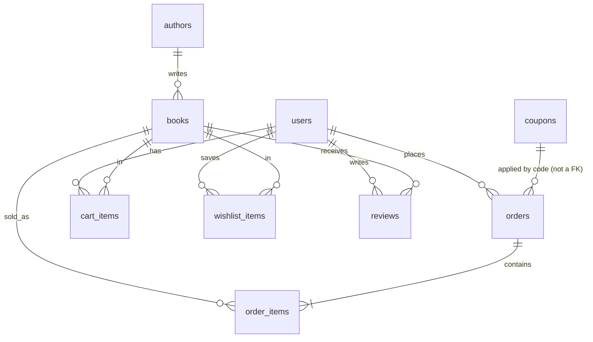

# Data model

Designed by hand from the wireframes (the deck lists this step as manual). Implemented in `backend/src/db.ts`.
SQLite is used so the project runs with no install; the SQL is standard and ports to PostgreSQL by changing types (`INTEGER PRIMARY KEY AUTOINCREMENT` → `SERIAL`, `TEXT` dates → `timestamptz`).

| Table | Purpose (wireframe it comes from) |
|---|---|
| `users` | login, gift `points` balance |
| `authors` | "by <author>" links, "About the writer" |
| `books` | catalogue cards and product page: title, description, publisher (brand), category, `tags` (the "Non-fiction, Self Help" links), format, language, `price` (₹), `stock`, `units_sold` (bestsellers, "N copies sold"), `published_at` (new launches) |
| `reviews` | product page reviews, 1–5 stars, text ≤ 100 chars, one per user per book |
| `cart_items` | basket, quantity 1–10 |
| `wishlist_items` | "My Wishlist" |
| `coupons` | "Apply Coupon" (flat or percent, minimum order, optional expiry) |
| `orders` | totals breakdown (subtotal, tax, delivery, discount, points), payment method, address snapshot, `placed_at` (drives the 48-hour cancel rule), status `CONFIRMED`/`CANCELLED` |
| `order_items` | books in an order with the price at purchase time (feeds order history, "Buy it again" and recommendations) |

Rules enforced in the database: price/stock/points ≥ 0, rating 1–5, review length ≤ 100, cart quantity 1–10, valid format and status values, unique email, foreign keys on.
Card numbers and CVV are never stored.
